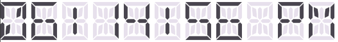

#  Getting Started with .NET MAUI Digital Gauge

## Creating an application using the .NET MAUI Digital Gauge

1. Create a new .NET MAUI application in Visual Studio.
2. Syncfusion .NET MAUI components are available in [nuget.org](https://www.nuget.org/). To add SfDigitalGauge to your project, open the NuGet package manager in Visual Studio, search for Syncfusion.Maui.Gauges and then install it.
3. To initialize the control, import the Gauges namespace.
4. Initialize [SfDigitalGauge]().

**[XAML]**
```
<ContentPage   
    . . .
    xmlns:gauge="clr-namespace:Syncfusion.Maui.Gauges;assembly=Syncfusion.Maui.Gauges">

    <gauge:SfDigitalGauge/>
</ContentPage>
```

**[C#]**
```
using Syncfusion.Maui.Gauges;
. . .

public partial class MainPage : ContentPage
{
    public MainPage()
    {
        this.InitializeComponent();
        SfDigitalGauge digitalGauge = new SfDigitalGauge();
        this.Content = digitalGauge;
    }
}   
```

## Register the handler

Syncfusion.Maui.Core Nuget is a dependent package for all Syncfusion controls of .NET MAUI. In the MauiProgram.cs file, register the handler for Syncfusion core.

**[C#]**
```
using Microsoft.Maui;
using Microsoft.Maui.Hosting;
using Microsoft.Maui.Controls.Compatibility;
using Microsoft.Maui.Controls.Hosting;
using Microsoft.Maui.Controls.Xaml;
using Syncfusion.Maui.Core.Hosting;

namespace DigitalGaugeGettingStarted
{
    public static class MauiProgram
    {
        public static MauiApp CreateMauiApp()
        {
            var builder = MauiApp.CreateBuilder();
            builder
            .UseMauiApp<App>()
            .ConfigureSyncfusionCore()
            .ConfigureFonts(fonts =>
            {
                fonts.AddFont("OpenSans-Regular.ttf", "OpenSansRegular");
            });

            return builder.Build();
        }
    }
}
```

## Display a value in Digital Gauge

The [Text]() property of the digital gauge is used to display a value. Initialize the SfDigitalGauge and display value using Text property.

**[XAML]**

```
<Grid>
    <gauge:SfDigitalGauge Text="06:14:56 PM" CharacterType="FourteenSegment" />
</Grid>
```

**[C#]**
```
using Syncfusion.Maui.Gauges;
. . .

public partial class MainPage : ContentPage
{
    public MainPage()
    {
        this.InitializeComponent();
        SfDigitalGauge digitalGauge = new SfDigitalGauge();
        digitalGauge.Text = "06:14:56 PM";
        digitalGauge.CharacterType = CharacterType.FourteenSegment;
        this.Content = digitalGauge;
    }
}
```

The following screenshot illustrates the result of the above code.

